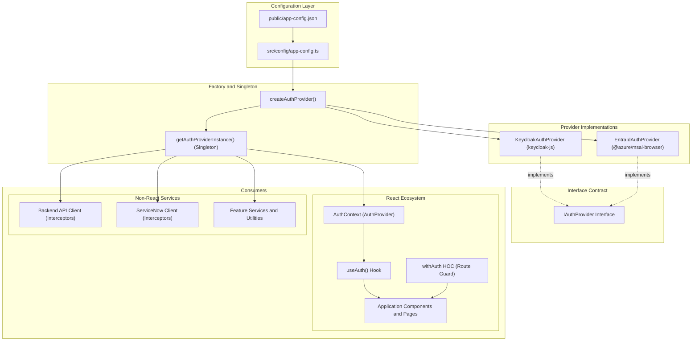
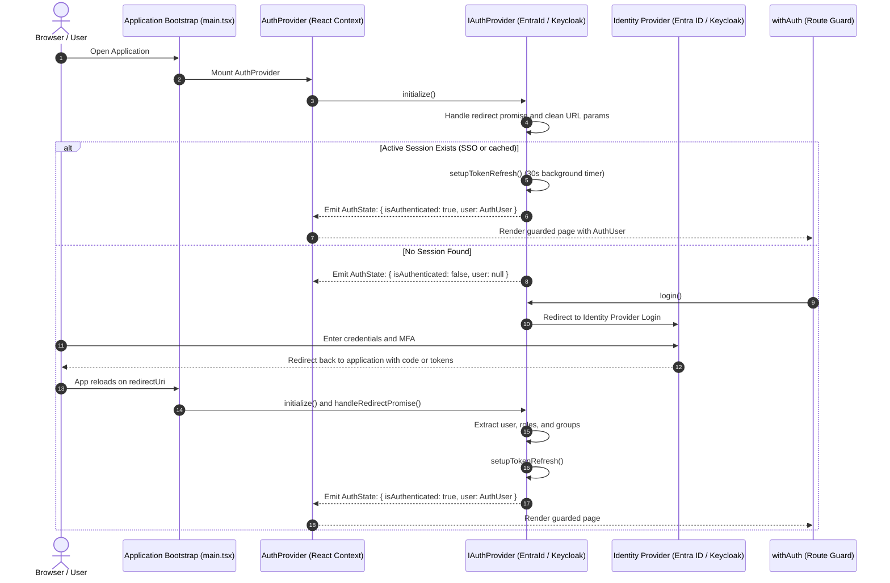
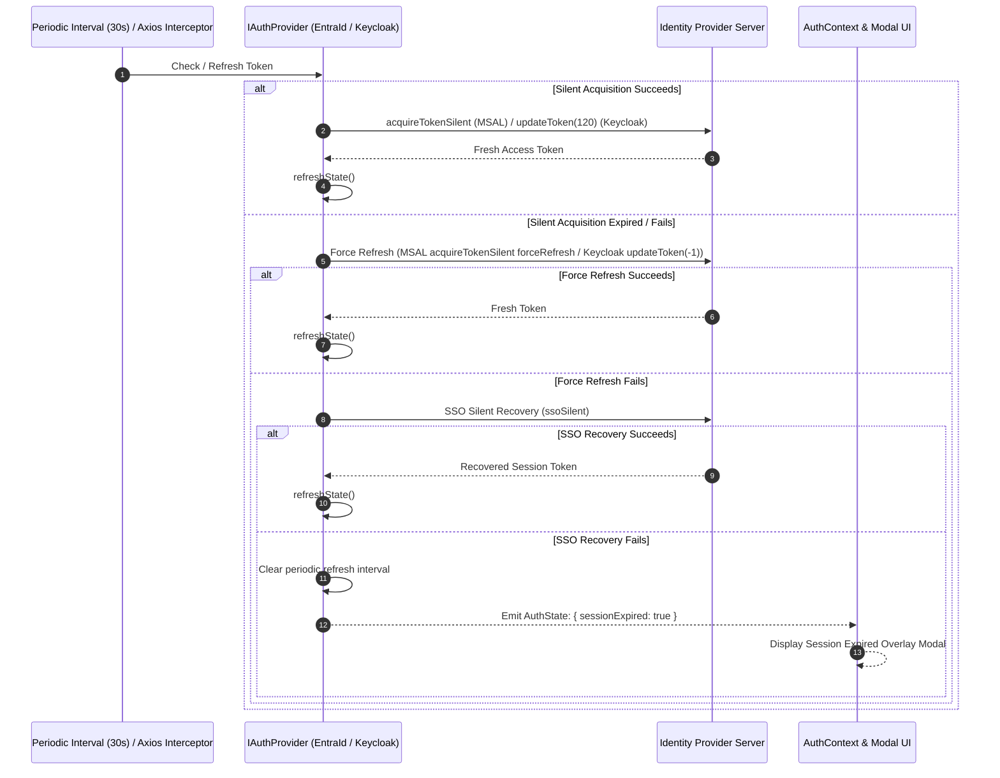

# Authentication Module

## Approach

The authentication module uses a **Strategy Pattern** to support multiple SSO identity providers (such as **Microsoft Entra ID** and **Keycloak**) behind a single unified interface
(`IAuthProvider`).

The application never imports provider-specific libraries (`@azure/msal-browser` or `keycloak-js`) into feature components. Instead, the UI and API layers rely exclusively on
shared abstractions:

- The React hook `useAuth()` inside React components.
- The route guard higher-order component `withAuth` for protecting pages.
- The singleton accessor `getAuthProviderInstance()` for non-React code (e.g., Axios interceptors, background services).

The active provider is configured at runtime via `appConfig.auth.provider` in `public/app-config.json` and validated by Zod in `src/config/app-config.ts`. Switching providers is a
one-line configuration update.

---

## Folder Structure

```
ITOpsToolkit_Frontend/
├── public/
│   └── app-config.json                         # Runtime configuration (active provider, client IDs, scopes, etc.)
├── src/
│   ├── config/
│   │   └── app-config.ts                       # Zod schemas (entraIdConfigSchema, keycloakConfigSchema, etc.)
│   └── shared/
│       └── modules/
│           └── auth/
│               ├── auth-provider-factory.ts    # Reads config and instantiates the active provider
│               ├── types/
│               │   └── auth.d.ts               # Core interfaces (IAuthProvider, AuthUser, AuthState, etc.)
│               ├── context/
│               │   └── AuthContext.tsx         # React context + <AuthProvider> wrapper
│               ├── hooks/
│               │   └── useAuth.ts              # useAuth() consumer hook for React components
│               ├── utils/
│               │   ├── get-auth-provider-instance.ts  # Singleton accessor for IAuthProvider
│               │   └── trim-url-trailing-slashes.ts   # URL sanitization helper
│               ├── components/
│               │   └── withAuth.tsx            # Route guard HOC (auto-login + session expired + error UI)
│               ├── providers/
│               │   ├── entra-id/
│               │   │   └── entra-id-auth-provider.ts  # Microsoft Entra ID (MSAL) implementation
│               │   └── keycloak/
│               │       └── keycloak-auth-provider.ts  # Keycloak OIDC implementation
│               └── services/
│                   ├── fetch-user-servicenow-details.ts     # ServiceNow sys_user fetcher
│                   ├── ms-graph-service.ts                  # MS Graph /me helper
│                   ├── revoke-user-keycloak-access-token.ts # Keycloak token revocation
│                   └── revoke-user-keycloak-refresh-token.ts
```

---

## Architectural Diagrams

### 1. Strategy Pattern Architecture



---

### 2. Initialization and Login Lifecycle



---

### 3. Token Acquisition & Proactive Refresh Flow



---

## Configuration

Both providers are configured centrally in `public/app-config.json` and validated by Zod in `src/config/app-config.ts`.

### Configuration in `public/app-config.json`

```json
{
    "userServiceNowUserIDKeyInAuth": "preferred_username",
    "servicenowSysUserQueryKey": "user_name",
    "auth": {
        "MAX_TOKEN_REFRESH_RETRIES": 20,
        "provider": "entra-id",
        "entraId": {
            "clientId": "a69f0055-f9c3-4661-a27a-1e877bd9caa0",
            "authority": "https://login.microsoftonline.com/9cb29d51-3db0-4220-ae12-f20feeb75497",
            "scopes": ["User.Read"],
            "redirectUri": "http://localhost:4000",
            "postLogoutRedirectUri": "http://localhost:4000"
        },
        "keycloak": {
            "url": "https://integration.autonomousitopstoolkit.com/auth",
            "realm": "AIOT",
            "clientId": "Check-AIOT",
            "identityProvider": "keycloak",
            "identityProviderAlias": "",
            "redirectUri": "http://localhost:4000",
            "postLogoutRedirectUri": "http://localhost:4000"
        }
    }
}
```

### Zod Validation Schema in `src/config/app-config.ts`

```ts
export const entraIdConfigSchema = z.object({
    clientId: z.string().min(1, 'Entra ID clientId is required'),
    authority: z.string().min(1, 'Entra ID authority is required'),
    scopes: z.array(z.string().min(1, 'Scope cannot be empty')).min(1, 'At least one scope is required').default(['User.Read']),
    redirectUri: z.string().min(1, 'Entra ID redirectUri is required'),
    postLogoutRedirectUri: z.string().min(1, 'Entra ID postLogoutRedirectUri is required'),
});

export const keycloakConfigSchema = z.object({
    url: z.string().min(1, 'Keycloak url is required'),
    realm: z.string().min(1, 'Keycloak realm is required'),
    clientId: z.string().min(1, 'Keycloak clientId is required'),
    identityProvider: z.enum(['keycloak', 'others'] as const),
    identityProviderAlias: z.string(),
    redirectUri: z.string().min(1, 'Keycloak redirectUri is required'),
    postLogoutRedirectUri: z.string().min(1, 'Keycloak postLogoutRedirectUri is required'),
});

export const authConfigSchema = z
    .object({
        MAX_TOKEN_REFRESH_RETRIES: z.number().default(20),
        provider: z
            .preprocess((val) => (val === 'entraId' ? 'entra-id' : val), z.enum(['keycloak', 'entra-id']))
            .optional()
            .default('keycloak'),
        entraId: entraIdConfigSchema.optional(),
        keycloak: keycloakConfigSchema.optional(),
    })
    .superRefine((auth, ctx) => {
        if (auth.provider === 'keycloak' && !auth.keycloak) {
            ctx.addIssue({
                code: z.ZodIssueCode.custom,
                message: 'auth.keycloak object is required when auth.provider is "keycloak"',
                path: ['keycloak'],
            });
        }
        if (auth.provider === 'entra-id' && !auth.entraId) {
            ctx.addIssue({
                code: z.ZodIssueCode.custom,
                message: 'auth.entraId object is required when auth.provider is "entra-id"',
                path: ['entraId'],
            });
        }
    });
```

---

## Provider Implementations

### Microsoft Entra ID (`EntraIdAuthProvider`)

Built with `@azure/msal-browser` (`PublicClientApplication`):

- **Dynamic Scopes**: Automatically consumes the configured `scopes` array from `appConfig.auth.entraId.scopes` (e.g. `['User.Read']`). Methods such as `getAccessToken()`,
  `login()`, `refreshToken()`, and tab focus re-auth all use these scopes.
- **Proactive Token Refresh**: Runs a background interval every 30 seconds to check and refresh tokens silently before expiration.
- **Session Recovery**: When silent acquisition fails, automatically attempts `ssoSilent` recovery before marking the session as expired.
- **Claims Extraction**: Parses ID token claims for `roles`, `groups`, and the user identifier configured in `appConfig.userServiceNowUserIDKeyInAuth`.
- **URL Parameter Cleanup**: Automatically strips authentication redirect query parameters (`code`, `state`, `session_state`, `error`) and URL hash fragments to keep the browser
  address bar clean.
- **Cache Revocation**: Implements `revokeAccessToken()` and `revokeRefreshToken()` by clearing cached token entries in `sessionStorage`.

### Keycloak (`KeycloakAuthProvider`)

Built with `keycloak-js`:

- **Identity Broker Support**: Provides `getkeycloakIdapBrokerAccessToken()` to retrieve enterprise IdP tokens from Keycloak broker endpoints.
- **Token Revocation**: Integrates with Keycloak's RFC 7009 revocation endpoints for access and refresh tokens.
- **Group and Role Parsing**: Extracts realm and client roles and group memberships from parsed tokens.

---

## Core Interfaces

### `AuthUser`

```ts
export interface AuthUser {
    id: string; // Subject ID or Local Account ID
    uniqueId: string; // Unique identifier mapped to ServiceNow user ID
    username: string; // Preferred username or UPN
    displayName: string; // Full name
    email?: string; // User email address
    tenantId?: string; // Tenant ID or Keycloak realm
    roles?: string[]; // Assigned roles
    groups?: string[]; // Assigned group memberships
    raw: unknown; // Provider-specific raw token/account payload
    userSnowDetails?: UserSnowDetails; // Associated ServiceNow sys_user record
}
```

### `IAuthProvider`

```ts
export interface IAuthProvider {
    initialize(): Promise<void>;
    login(): Promise<void>;
    logout(): Promise<void>;
    revokeAccessToken(): Promise<void>;
    revokeRefreshToken(): Promise<void>;
    getUser(): AuthUser | null;
    getAccessToken(scopes?: string[]): Promise<string>;
    getkeycloakIdapBrokerAccessToken?(): Promise<string>;
    getRefreshToken(): Promise<string>;
    refreshToken(): Promise<string>;
    isAuthenticated(): boolean;
    getState(): AuthState;
    subscribe(callback: AuthStateChangeCallback): () => void;
    getUserSnowDetails: () => Promise<UserSnowDetails>;
    getUserMemberOfGroups: () => Promise<Array<string>>;
    hasGroupMembership(group: string): boolean;
}
```

---

## How to Switch Providers

1. Open `public/app-config.json`.
2. Change `"provider"` under `"auth"`:
    - For Keycloak: `"provider": "keycloak"`
    - For Entra ID: `"provider": "entra-id"`
3. Verify that the matching configuration object (`keycloak` or `entraId`) has valid endpoints and credentials.
4. Save and restart/reload the application.

---

## Usage Guide

### 1. In React Components (`useAuth`)

```tsx
import React from 'react';
import { useAuth } from '@/shared/modules/auth/hooks/useAuth';

export const UserProfileWidget: React.FC = () => {
    const { state, logout, getAccessToken } = useAuth();

    if (!state.isAuthenticated || !state.user) {
        return null;
    }

    const handleCopyToken = async () => {
        const token = await getAccessToken();
        await navigator.clipboard.writeText(token);
    };

    return (
        <div>
            <h3>Welcome, {state.user.displayName}</h3>
            <p>Username: {state.user.username}</p>
            <p>Tenant: {state.user.tenantId}</p>
            <button onClick={handleCopyToken}>Copy Access Token</button>
            <button onClick={() => logout()}>Sign Out</button>
        </div>
    );
};
```

### 2. Protecting Routes (`withAuth`)

Wrap pages or route components with `withAuth`. It handles initialization spinners, auto-login redirect when unauthenticated, and the session expiry modal.

```tsx
import withAuth, { type WithAuthProps } from '@/shared/modules/auth/components/withAuth';

interface DashboardPageProps extends WithAuthProps {
    title?: string;
}

const DashboardPage: React.FC<DashboardPageProps> = ({ user }) => {
    return (
        <div>
            <h1>Dashboard</h1>
            <p>
                Logged in as: {user.displayName} ({user.uniqueId})
            </p>
        </div>
    );
};

export default withAuth(DashboardPage);
```

### 3. Outside React (Axios Interceptors & Services)

Use `getAuthProviderInstance()` to obtain the singleton instance:

```ts
import { getAuthProviderInstance } from '@/shared/modules/auth/utils/get-auth-provider-instance';
import type { InternalAxiosRequestConfig } from 'axios';

export const applyAuthTokenInterceptor = async (config: InternalAxiosRequestConfig) => {
    const authProvider = getAuthProviderInstance();
    const token = await authProvider.getAccessToken();

    if (token && config.headers) {
        config.headers['Authorization'] = `Bearer ${token}`;
    }

    return config;
};
```

---

## Verification & Testing

To test authentication behavior in development:

- Navigate to the `/DevTestSpace` route to test token retrieval, manual refresh, and token revocation for either active provider.
- Press `Ctrl + Shift + E` in development to simulate session expiration and verify the session renewal dialog.
